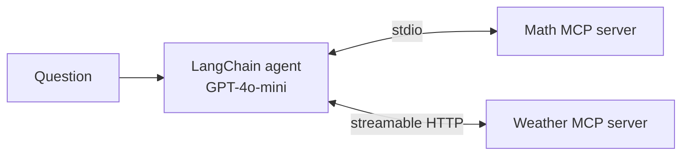

# 🔌 MCP Demo: A LangChain Agent Using Two Tool Servers

The **Model Context Protocol (MCP)** is an open standard for connecting AI applications to tools and data. Instead of hard-coding tools into an agent, you run them as MCP **servers**, and any MCP-compatible client can discover and use them.

This demo builds two servers with **FastMCP** and connects one LangChain agent to both.



| File | Role |
|------|------|
| [`mathserver.py`](mathserver.py) | `add`, `subtract`, `multiply` and `divide` tools over the **stdio** transport. The client starts it as a subprocess. |
| [`weather.py`](weather.py) | A `get_weather` tool over **streamable HTTP**, running as its own service at `http://localhost:8000/mcp`. It returns a fixed demo reply, not live weather. |
| [`client.py`](client.py) | `MultiServerMCPClient` loads the tools from both servers and passes them to `create_agent`. The agent picks the right tool for each question. |

## Run it

```bash
uv sync                     # or: pip install -r requirements.txt
```

Create a `.env` file in this folder:

```env
OPENAI_API_KEY=your_key
```

Then use two terminals:

```bash
uv run weather.py           # terminal 1: start the weather server
uv run client.py            # terminal 2: starts the math server and runs the agent
```

Expected output: the agent answers "What is (3+5)*2?" with the math tools and "What is the weather in New York?" with the weather tool.

## Key ideas

- **Transports:** `stdio` suits local tools launched by the client; `streamable-http` suits tools that run as separate, shareable services.
- **Tool discovery:** the client asks each server which tools it offers. The agent code never hard-codes them.
- **Reuse:** the same servers work with any MCP client, including desktop AI apps.

## Tech

MCP (FastMCP) · langchain-mcp-adapters · LangChain v1 · OpenAI
