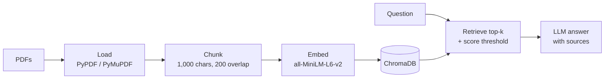

# 📚 RAG Pipeline: Ask Questions About Your Own PDFs

An end-to-end retrieval-augmented generation (RAG) pipeline, built component by component: load documents, split them into chunks, embed them, store them in a vector database, retrieve the most relevant chunks for a question, and have an LLM answer from them.



## Notebooks

| Notebook | What it covers |
|----------|----------------|
| [01 – Document components](Notebook/01%20-%20Langchain%20Document%20Components.ipynb) | LangChain `Document` objects and metadata; loading text and PDF files with `TextLoader`, `DirectoryLoader`, `PyPDFLoader` and `PyMuPDFLoader` |
| [02 – RAG pipeline](Notebook/02%20-%20RAG%20Pipeline.ipynb) | The full pipeline: batch PDF ingestion, recursive chunking, an `EmbeddingManager`, a ChromaDB `VectorStore`, a `RAGRetriever`, and simple and advanced RAG functions |

## Results

- 5 PDFs (92 pages) split into **221 chunks** and embedded as 384-dimensional vectors.
- Retrieval uses a **similarity-score threshold**, so weak matches are left out of the prompt.
- `rag_advanced()` returns the **answer, retrieved context, sources and a confidence score**.

## Run it

```bash
uv sync                     # or: pip install -r requirements.txt
```

Create a `.env` file in this folder:

```env
OPENAI_API_KEY=your_key
```

Put your PDFs in `Data/pdf_files/`, then open the notebooks in order and select the project's `.venv` kernel. The ChromaDB index is created in `Data/chroma_db/`.

## Tech

LangChain · Sentence Transformers (`all-MiniLM-L6-v2`) · ChromaDB · PyPDF · PyMuPDF · OpenAI

## Next steps

- Move the `EmbeddingManager`, `VectorStore` and `RAGRetriever` classes into the `src/` package.
- Add citations and conversation history to the advanced pipeline.
- Add hybrid search (BM25 + embeddings) and a reranker, and measure retrieval quality with recall@k on a small question set.
