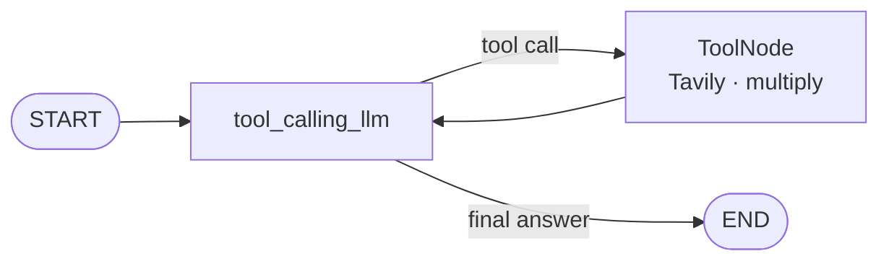

<div align="center">

# 🐍 Python Projects

**A hands-on portfolio of Python work — from Generative AI agents with LangChain & LangGraph to machine learning, data analysis and command-line tools.**


</div>

---

## 👋 About

I'm **Rakshith Dheer Reddy Kunduru**, an MSc Data Analytics graduate (Dublin Business School) with three years' experience as a Software Engineer building C# .NET MVC APIs and T-SQL back ends. This repository is where I build and document my work in **Python, AI and data** — each folder is a self-contained project or learning track.

**Focus areas:** Generative AI & LLM agents · Machine Learning · Deep Learning · Data Analysis · Python engineering

---

## ⭐ Featured Work

### 1. 🤖 LangChain v1 — Building LLM Applications
📁 [`Learn Langchain/Updated Langchain`](Learn%20Langchain/Updated%20Langchain)

A six-part, notebook-based series working through the modern **LangChain v1** API with real model calls across three providers.

| # | Notebook | What it covers |
|---|----------|----------------|
| 01 | [LangChain Intro](Learn%20Langchain/Updated%20Langchain/01%20-%20Langchain%20Intro.ipynb) | LangChain v1 concepts and creating a first agent |
| 02 | [Model Integration](Learn%20Langchain/Updated%20Langchain/02%20-%20Model%20Integration.ipynb) | Integrating **OpenAI (GPT-4.1)**, **Google Gemini** and **Groq**; streaming and batch inference |
| 03 | [Tools](Learn%20Langchain/Updated%20Langchain/03%20-%20Tools.ipynb) | Defining tools with `@tool`, `bind_tools`, `create_agent`, and a manual tool-execution loop |
| 04 | [Messages](Learn%20Langchain/Updated%20Langchain/04%20-%20Messages.ipynb) | Text vs. message prompts; System, Human and AI messages |
| 05 | [Structured Output](Learn%20Langchain/Updated%20Langchain/05%20-%20Structured%20Ouput.ipynb) | Typed LLM responses with **Pydantic**, `TypedDict` and dataclasses, including nested schemas |
| 06 | [Middleware](Learn%20Langchain/Updated%20Langchain/06%20-%20Middleware.ipynb) | Production-style agent controls: **summarisation** (message-, token- and fraction-based), **human-in-the-loop** approve / edit / reject of tool calls, and checkpointed memory with `InMemorySaver` |

**Highlights**
- Human-in-the-loop email agent that **pauses before sending** and resumes on approve, reject or edit via LangGraph `Command`.
- Conversation summarisation tested against long multi-turn runs to keep agents inside their context window.
- Provider-agnostic setup with `init_chat_model`, so models can be swapped without code changes.

---

### 2. 🕸️ LangGraph — Stateful Agent Workflows
📁 [`Learn Langgraph`](Learn%20Langgraph)

Building agents as graphs of **nodes, edges and shared state** using the LangGraph Graph API.

- **Basic chatbot** — a `StateGraph` with an `add_messages` reducer, compiled, visualised as a Mermaid diagram, and run with both `invoke` and `stream`.
- **Tool-calling chatbot** — combines live web search (**Tavily**) with a custom Python function, routed through `ToolNode` and `tools_condition`.
- **Designed next:** a *YouTube-to-blog* pipeline — transcript → title → full blog post — as a multi-node graph.



---

### 3. 🎮 Rock Paper Scissors — CLI Game
📁 [`Terminal Line /Rock Paper Scissors`](Terminal%20Line%20/Rock%20Paper%20Scissors)

A terminal game with **three modes**: *Normal*, *No Draw* (draws are replayed) and *Impossible* (the computer always counters your move). The winner is decided with a compact modular-arithmetic rule — `(user - computer) % 3 == 1` — and all input is validated.


---

## 🧰 Command-Line Utilities
📁 [`Terminal Line /`](Terminal%20Line%20)

| Project | Description | Key concepts |
|---------|-------------|--------------|
| [Rock Paper Scissors](Terminal%20Line%20/Rock%20Paper%20Scissors) | Three-mode game against the computer | Game loop, modular arithmetic, input validation |
| [Password Generator](Terminal%20Line%20/Password%20Generator) | Builds a password from user-chosen character sets | String handling, randomisation |
| [Currency Converter](Terminal%20Line%20/Currency%20Convertor) | Converts between USD, EUR, GBP and JPY via a USD base rate | Functions, error handling |
| [Emoji Decoder](Terminal%20Line%20/Emoji%20Decoder) | Turns emojis in text into readable names | Third-party library (`emoji`) |

<details>
<summary>📸 Screenshots</summary>


</details>

---

## 🚧 In Progress

These tracks are set up and being built out:

| Area | Folder | Planned topics |
|------|--------|----------------|
| 📊 Machine Learning | [`ML Algorithms`](ML%20Algorithms) | Linear & Logistic Regression, Decision Tree, Random Forest, SVM, K-Means, Ensemble techniques |
| 🧠 Deep Learning | [`Deep Learning`](Deep%20Learning) | ANN, CNN, RNN, Transformers & attention, RAG, YOLO object detection, face recognition, cat-vs-dog and skin-disease image classification |
| 📈 Data Analysis | [`Data Analysis`](Data%20Analysis) | House-price prediction, product-price evaluation |
| 🧮 Algorithms | [`Competative Programming`](Competative%20Programming) | Searching, sorting, linked lists, graphs |
| 🐍 Python Foundations | [`Learn Python`](Learn%20Python) | Indentation, syntax, comments, variables |
| 🕹️ Games & Web | [`PyGames`](PyGames), [`Web Applications`](Web%20Applications) | Chess, dinosaur runner, school website |

---

## 🛠️ Tech Stack

| Category | Tools |
|----------|-------|
| **Language** | Python 3.10+ |
| **Generative AI** | LangChain v1, LangGraph, LangSmith, OpenAI, Google Gemini, Groq, Tavily |
| **Data & ML** | NumPy, pandas, scikit-learn, Matplotlib, Seaborn |
| **Deep Learning** | TensorFlow |
| **Validation** | Pydantic, `typing` / `TypedDict` |
| **Tooling** | Jupyter, [uv](https://github.com/astral-sh/uv), python-dotenv, Git |

---

## 🚀 Getting Started

```bash
# 1. Clone the repository
git clone https://github.com/Dheer08/Python-Projects.git
cd Python-Projects
```

**Run a command-line project**
```bash
cd "Terminal Line /Rock Paper Scissors"
python main.py
```

**Run the LangChain / LangGraph notebooks** (managed with `uv`)
```bash
cd "Learn Langgraph"          # or "Learn Langchain"
uv sync                       # creates .venv and installs dependencies
# or: pip install -r requirements.txt
```

Create a `.env` file in that folder with the keys the notebooks use:
```env
OPENAI_API_KEY=your_key
GOOGLE_API_KEY=your_key
GROQ_API_KEY=your_key
TAVILY_API_KEY=your_key
```

Then open the notebooks in Jupyter or VS Code and select the project's `.venv` kernel.

---

## 📂 Repository Structure

```
Python-Projects/
├── Learn Langchain/          # LangChain v1 series (6 notebooks)
├── Learn Langgraph/          # LangGraph agent workflows
├── Terminal Line /           # CLI apps: games and utilities
├── ML Algorithms/            # Classical machine learning
├── Deep Learning/            # Neural networks, CV, NLP, RAG
├── Data Analysis/            # Exploratory analysis & prediction
├── Competative Programming/  # Data structures & algorithms
├── Learn Python/             # Python fundamentals
├── PyGames/                  # Games
├── Web Applications/         # Web apps
└── LICENSE
```

---

## 📬 Contact

**Rakshith Dheer Reddy Kunduru** — Dublin, Ireland

[](https://github.com/Dheer08)
[](https://www.linkedin.com/in/rakshith-dheer-reddy-446718189)

---

<div align="center">

Licensed under the [MIT License](LICENSE) · ⭐ Star the repo if you find it useful

</div>